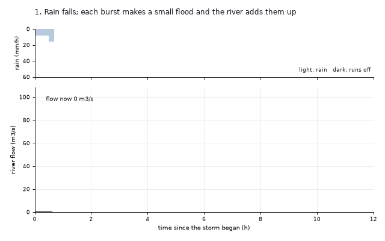
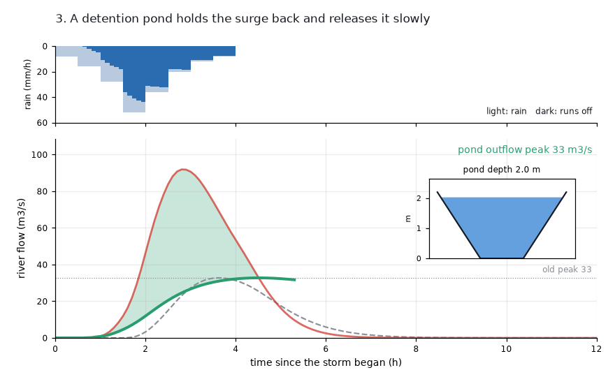
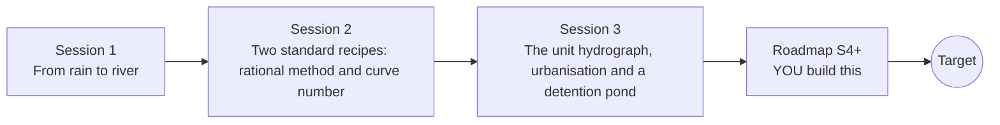

# openwatershed

[](https://github.com/KrunalPanchal1995/openwatershed/actions/workflows/ci.yml)   [](https://colab.research.google.com/github/KrunalPanchal1995/openwatershed/blob/main/sessions/session-01/lesson.ipynb) [](https://krunalpanchal1995.github.io/openwatershed/)

**Predict how high a river rises when it rains, in three sessions.**

openwatershed teaches how rain on a catchment becomes a flood hydrograph, from soak-in and run-off to unit hydrographs and a detention pond, using only Python and a browser.

- **Start from the rain.** Session 1 needs only school arithmetic: rain depth, area and time.
- **See the flood build.** Every session ships a slider app with labelled graphs that runs in the browser.
- **Know you got it right.** Each session ends with a checkpoint that prints PASS or FAIL against hand calculations.
- **Build the missing half.** The repo stops at Session 3 on purpose; the roadmap shows the path to the Target.

[Target](#the-target) · [Who is this for](#who-is-this-for) · [Quick start](#quick-start) · [Sessions](#sessions) · [Roadmap](#roadmap) · [Contribute](#contribute) · [Explainer PDF](docs/explainer.pdf)

> **This repo is incomplete on purpose.** Sessions 1 to 3 are here and fully working. The finished Target below is a preview of what the community can build next. We show you the path, not the code. Sessions 4 and up are yours.

## The Target

One made-up valley, one storm, three acts. First each burst of rain makes its own small flood and the river adds them up. Then the valley is paved and the same storm gives a much taller, earlier flood. Finally a detention pond with sloping banks and an orifice holds the surge back and brings the peak down to its old value. Your goal over the coming sessions: build that pipeline yourself, from rainfall to a pond that protects the town. Educational model only; real flood design belongs to qualified hydrologists.



*Target: storm, unit hydrograph, urbanisation and a detention pond (animation)*



*Target still: the pond holds the paved-valley flood to the old peak*

Try it live:

- [Math Visual Studio: open the Studio and explore](https://krunalpanchal1995.github.io/studio/)

How the Target was made is shown only as a path in [promo/roadmap.md](promo/roadmap.md).

## Who is this for
**secondary school to diploma / undergraduate (levels 3-5).** Topic area: Geography, Climate, Environment and Earth Science.

Prerequisites:

- School arithmetic with units (mm, m, km2, hours) and the idea of a graph.
- Python 3.10 or newer; if `python --version` works, you are ready. PRIMER.md explains the rest.
- No prior GitHub, hydrology or calculus experience is needed. Pipe hydraulics is in openpipeflow and retaining structures in openretainingwall; this repo only follows the water to the river.

New to Python? Read [PRIMER.md](PRIMER.md) first (10 minutes).

## Quick start

No installation knowledge needed. You need [Git](https://git-scm.com/downloads) and [Python 3.10+](https://www.python.org/downloads/) (Windows: tick "Add Python to PATH"). On Mac and Linux type `python3` wherever this page says `python`.

```bash
git clone https://github.com/KrunalPanchal1995/openwatershed.git
cd openwatershed
python start.py 1
```

`start.py` creates a private environment, installs what is needed and runs Session 1 with its checkpoint. Next: `python start.py 2`, `python start.py 3`, or `python start.py test` to check everything. Only a checkpoint: `python start.py check 1`.

Four lines turn the idea of Session 2 into a result (they work as they are): Save it as `try.py` and run it with `python start.py run try.py` (this uses the private environment, where NumPy is installed):

```python
import numpy as np
CN, P = 80, 100.0                           # curve number 80, a 100 mm storm
S = 25400 / CN - 254                        # mm the ground can still hold
Q = (P - 0.2 * S) ** 2 / (P - 0.2 * S + S)  # run-off depth in mm
print(np.round(Q, 1))                       # -> 50.5 mm of the 100 mm runs off
```

Every session also opens in your browser with sliders (no install): [live apps](https://krunalpanchal1995.github.io/openwatershed/). Or use the Colab badge above for the notebook.

## Sessions

| # | Session | Model level | Time | Live app |
|---|---|---|---|---|
| 1 | [From rain to river](sessions/session-01/README.md) | Level 1: conceptual interactive model | 60 min | [open](https://krunalpanchal1995.github.io/openwatershed/session-01/) |
| 2 | [Two standard recipes: rational method and curve number](sessions/session-02/README.md) | Level 2: mathematical engineering model | 75 min | [open](https://krunalpanchal1995.github.io/openwatershed/session-02/) |
| 3 | [The unit hydrograph, urbanisation and a detention pond](sessions/session-03/README.md) | Level 3: simulation and validation | 90 min | [open](https://krunalpanchal1995.github.io/openwatershed/session-03/) |

Each session follows the same six steps: A real-world problem, B concept and theory, C visual explanation, D interactive simulation, E worked example and experiment, F assessment and design challenge. Each ends with `checkpoint.py`, which prints `PASS` or `FAIL` against reference numbers. Session 3 also contains the real-world mini-project: **Urbanise a valley and size the detention pond**.

## Architecture



| Folder or file | What is inside |
|---|---|
| `sessions/` | three sessions: README (A-F), `lesson.py`, notebook, live app, exercises, activity sheet, checkpoint |
| `promo/` | the Target: media, live links, and the roadmap (path only) |
| `docs/` | `explainer.tex` and the built `explainer.pdf` |
| `tests/` | runs every lesson and checkpoint headless |
| `start.py` | one command to set up and run anything |
| `QUALITY.md`, `RUBRIC.md` | the quality checklist and the scoring rubric |
| `.github/` | CI, PDF build, Pages deploy, issue and PR templates |

## Roadmap

| Milestone | What you will build | Difficulty |
|---|---|---|
| Session 4: Design storms from a rainfall curve | A function that builds a design storm of a chosen duration from an intensity curve and feeds it to the unit hydrograph. | intermediate |
| Session 5: A smoother unit hydrograph | A second UH function with the same volume and a smooth rising limb. | intermediate |
| Session 6: Ponds with sloping banks and a spillway | A level-pool router with a sloping-bank pond, an orifice and an overflow weir. | advanced |
| Session 7: Two sub-catchments joined by a river | A model that computes two sub-catchment hydrographs, routes one through Muskingum and adds them. | advanced |
| Session 8: Calibrate against an observed flood | A least-squares fit of CN and Tc to a synthetic observed hydrograph with added noise. | advanced |

Full detail with a checkpoint per milestone: [promo/roadmap.md](promo/roadmap.md).

## Contribute
New to GitHub? Read [CONTRIBUTING.md](CONTRIBUTING.md); it starts from zero. Pick an issue labelled `good first issue`. Translations into Hindi, Telugu, Tamil and Malayalam are welcome.

<details>
<summary>Development</summary>

```bash
python start.py test        # runs every lesson and checkpoint
```
Lessons use `# %%` cell markers so they open as notebooks in VS Code. See [QUALITY.md](QUALITY.md) for the standard every session meets.
</details>

## License
MIT. See [LICENSE](LICENSE). Media in `promo/media` is (c) Krunal Panchal, CC BY 4.0.

## Acknowledgments
Part of the [PAN IIT OSS](https://hellofoss.tech-iitb.org/projects) open-source teaching collection, modelled on the structure of [openspline](https://github.com/openspline/openspline). Built on ideas from the Math Visual Studio at https://krunalpanchal1995.github.io/studio/.
