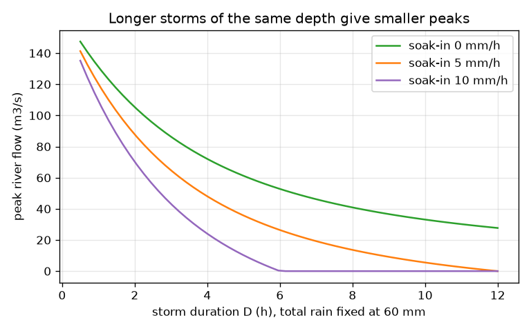
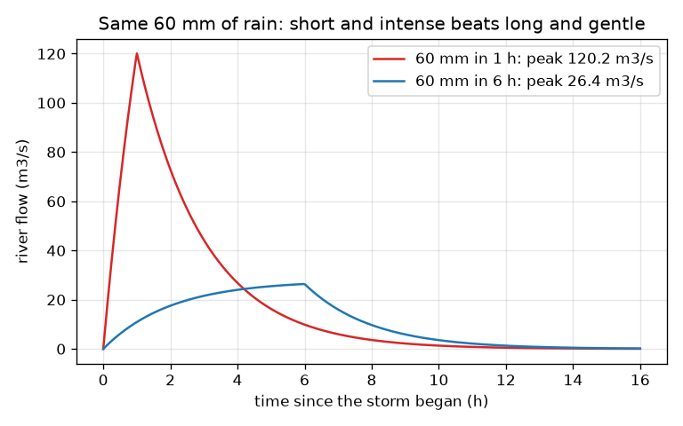

# Session 1: From rain to river

*Level 1 (conceptual interactive model) · about 60 minutes · openwatershed*

> This is a simplified educational model. It is not a validated design tool and must not be used for real structures, electrical installations, vehicles, industrial processes or medical decisions.

**Prerequisites**

- School arithmetic with units: mm, km2, hours.
- You have read PRIMER.md and run `python start.py 1` once.

**Learning objectives.** After this session you can:

- Split rain into water that soaks in and water that runs off.
- Convert a run-off depth rate (mm/h) over an area (km2) into a flow in m3/s.
- Explain how a catchment delays and smooths the water on its way to the river.
- Explain why a short intense storm can give a taller flood than a long gentle one with the same rain depth.

## A. Real-world problem
A storm drops the same 60 mm of rain on the hills above a town twice: once in 1 hour, once spread over 6 hours. In which case does the river rise higher? The answer decides how high a bridge or a flood wall must be. This lesson is a simplified teaching model: real flood forecasts come from official agencies and qualified hydrologists.

## B. Concept and theory
The ground can swallow water at a rate f (mm per hour), like a sponge. Rain that falls faster than f cannot soak in, so the excess runs off over the surface. Run-off is a depth rate (mm/h) spread over the catchment area A (km2); 1 mm of water over 1 km2 is 1000 m3, so 1 mm/h over 1 km2 is 1000 m3 per hour = 0.2778 m3/s, and flow in m3/s is depth rate times area divided by 3.6. The water does not reach the river at once: it trickles down slopes and gullies. The simplest picture is a tank with a leak (a linear reservoir) with delay K: if the run-off flow is q for D hours, the river flow rises as q(1 - exp(-t/K)), reaches q(1 - exp(-D/K)) at the end of the storm, then falls away. A storm much shorter than K never lets the river reach q, which is why a long gentle storm of the same depth gives a smaller peak.

| Symbol | Meaning | Unit |
|---|---|---|
| P | total storm rain depth | mm |
| D | storm duration | h |
| i = P / D | rain intensity | mm/h |
| f | soak-in rate of the ground | mm/h |
| A | catchment area (20 in this lesson) | km2 |
| K | catchment delay (2 in this lesson) | h |
| q | run-off flow | m3/s |
| Q_peak | river peak flow | m3/s |

**Assumptions**

- Rain is even over the whole catchment and over the storm duration.
- The soak-in rate f is constant (real soil slows down as it fills).
- The catchment behaves as one linear reservoir with delay K.
- Educational model: not a forecast and not a design method.

$$ \text{run-off rate}=\max(i-f,\,0)\qquad i=P/D $$

$$ q=\frac{\max(i-f,0)\,A}{3.6}\quad\left(\tfrac{\text{mm}}{\text{h}}\cdot\text{km}^2\to\text{m}^3/\text{s}\right) $$

$$ Q(t)=q\left(1-e^{-t/K}\right)\ (t\le D),\qquad Q_{\text{peak}}=q\left(1-e^{-D/K}\right) $$

$$ Q(t)=Q_{\text{peak}}\,e^{-(t-D)/K}\ (t>D) $$

## C. Visual explanation
The first figure shows the river flow from two storms that both drop 60 mm: the 1 hour storm gives a tall narrow flood with a peak of 120.2 m3/s, the 6 hour storm a low wide one with a peak of 26.4 m3/s. The second figure fixes the rain at 60 mm and plots the peak against the storm duration for three soak-in rates: every curve falls as the storm lengthens, and a soak-in rate of 10 mm/h removes the flood altogether for long storms.

*Peak river flow against storm duration for three soak-in rates.*

*Same 60 mm of rain: the 1 h storm gives a peak of 120.2 m3/s, the 6 h storm 26.4 m3/s.*

## D. Interactive simulation
Run the lesson (`python start.py 1`), then open the live app: [Session 1: rain to river](https://krunalpanchal1995.github.io/openwatershed/session-01/) (or `app.html` in this folder). Set the rain depth to 60 mm and slide the duration from 12 h down to 0.5 h: watch the river thicken in the picture and the peak climb in the graph. Then raise the soak-in rate.

**Challenge.** Make the river peak exceed 100 m3/s using at most 60 mm of rain and a soak-in rate of at least 5 mm/h.

## E. Worked example and experiment
**Problem.** 60 mm of rain falls in 1 h on a 20 km2 catchment with f = 5 mm/h and K = 2 h. Find the run-off flow and the river peak. Then do the same for 60 mm in 6 h.

1. Intensity i = 60 / 1 = 60 mm/h. Run-off rate = 60 - 5 = 55 mm/h.
2. Flow q = 55 * 20 / 3.6 = 305.6 m3/s.
3. Peak = 305.6 * (1 - exp(-1/2)) = 305.6 * 0.3935 = 120.2 m3/s.
4. 6 h storm: i = 10 mm/h, run-off rate 5 mm/h, q = 5 * 20 / 3.6 = 27.78 m3/s.
5. Peak = 27.78 * (1 - exp(-6/2)) = 27.78 * 0.9502 = 26.4 m3/s.
6. Run-off volumes: 55 mm gives 1100 thousand m3 and 30 mm gives 600 thousand m3 over the 20 km2.

**Answer.** The short storm gives a peak of 120.2 m3/s and the long one 26.4 m3/s: more than four times lower for the same 60 mm of rain.

**Experiment.** Pour water at a steady rate into a bucket with a hole near the bottom and a sponge on top (the sponge is the soak-in, the hole is the catchment delay). Pour 1 litre quickly, then 1 litre slowly, and watch the highest flow out of the hole. The quick pour gives the higher flow. The model differs from reality because real soil changes its soak-in rate as it fills and real catchments have many different flow paths, not one tank.

## F. Assessment and design challenge
**Question type A: Conceptual.** Why can a storm with less total rain sometimes cause a bigger flood than a storm with more rain?

Hint

Think about the two things that matter: how fast the rain arrives compared with the soak-in rate, and how long the catchment needs to gather the water.

Step-by-step solution

Run-off starts only when intensity exceeds the soak-in rate, and the river peak depends on how much run-off arrives within the delay time K. A short intense storm of modest depth can exceed f by a lot and deliver its water inside K, giving a high peak, while a long gentle storm of larger depth may stay near f and spread its water out. In this model, 60 mm in 1 h gives 120.2 m3/s but 60 mm in 6 h only 26.4 m3/s.

**Question type B: Numerical.** 60 mm of rain falls in 2 h on the 20 km2 catchment (f = 5 mm/h, K = 2 h). Find the river peak and check the units.

Hint

i = P / D, then run-off rate, then flow = rate * area / 3.6, then multiply by 1 - exp(-D/K).

Step-by-step solution

i = 30 mm/h, run-off rate 25 mm/h, q = 25 * 20 / 3.6 = 138.9 m3/s, peak = 138.9 * (1 - exp(-1)) = 138.9 * 0.6321 = 87.8 m3/s. Units: mm/h * km2 / 3.6 gives m3/s. Sanity check: it lies between the 1 h answer (120.2) and the 6 h answer (26.4).

**Question type C: Graph and simulation interpretation.** In the graph of peak against duration (rain fixed at 60 mm), what do the 0 and 10 mm/h curves tell you at D = 6 h? What happens as D gets small?

Hint

Read the curves at D = 6 and at the left edge of the graph.

Step-by-step solution

With no soak-in (0 mm/h) the 6 h storm gives a peak of 52.8 m3/s while with 10 mm/h it gives zero because the intensity (10 mm/h) does not exceed f. As D gets small the peak rises towards the ceiling set by the full intensity: with f = 0 the 1 h storm already gives 131.2 m3/s and with f = 5 the 0.5 h storm gives 141.3 m3/s. All curves fall as the storm lengthens.

**Question type D: Design and optimisation challenge.** Design: land use changes can raise f from 5 to 10 mm/h (for example, more open soil and trees). For the 60 mm, 1 h storm, does that bring the peak below 100 m3/s? What else would you change, and what do you assume?

Hint

Compute the peak with f = 10 and compare with 100; then think about K and the storm duration.

Step-by-step solution

With f = 10 the 1 h peak is 109.3 m3/s, down from 120.2 but still above 100. Raising f helps only a little against an intense storm; storing water or slowing it (a larger K) would be needed. Assumptions: f is constant, the storm is even, and the catchment is one tank. A real designer uses official rainfall data and checks several storm durations.

Score yourself with [RUBRIC.md](../../RUBRIC.md). Print the [activity sheet](activity_sheet.md) to work on paper.

## Common misconceptions
| Common misconception | What is actually true |
|---|---|
| More total rain always means a bigger flood. | The peak depends on the intensity compared with the soak-in rate and on how fast the catchment gathers the water; the same depth can give very different peaks. |
| All the rain that falls ends up in the river quickly. | Some soaks in, and the rest is delayed by the time the catchment needs to gather it, so the river peak is lower and later than the run-off rate. |
| A flow in mm/h cannot be compared with a flow in m3/s. | They are the same thing with different units: multiply by the area and divide by 3.6. |

## Glossary
- **catchment**: the area of land whose rain drains to one point on a river (also called a watershed)
- **run-off**: the part of the rain that flows over the ground instead of soaking in
- **infiltration**: water soaking into the ground
- **hydrograph**: a graph of river flow against time
- **linear reservoir**: a tank that drains at a rate proportional to the water stored in it

## Finish
1. Do the three coding tasks in [exercises.md](exercises.md).
2. Run `python start.py 1` again after your changes. It ends with the checkpoint; when it prints `PASS`, you are done. (Checkpoint only: `python start.py check 1`.)

Next: [Session 2](../session-02/README.md)
