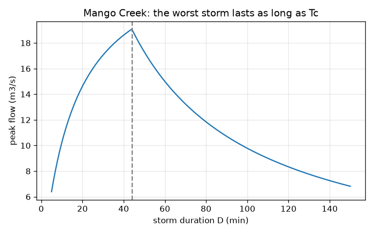
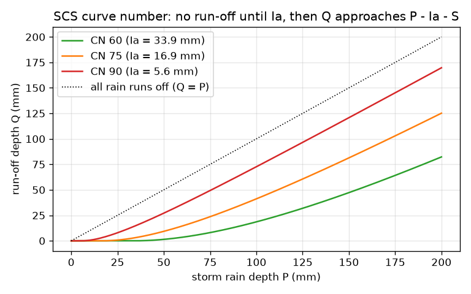

# Session 2: Two standard recipes: rational method and curve number

*Level 2 (mathematical engineering model) · about 75 minutes · openwatershed*

> This is a simplified educational model. It is not a validated design tool and must not be used for real structures, electrical installations, vehicles, industrial processes or medical decisions.

**Prerequisites**

- Session 1: run-off and the unit factor 3.6.
- Powers and fractions; no calculus needed.

**Learning objectives.** After this session you can:

- Use the rational method Q = C i A / 3.6 and verify the factor 3.6 by hand.
- Compute run-off depth with the SCS curve number method and check its limits.
- Estimate a time of concentration and explain why the design storm lasts Tc.
- Solve a design problem for a made-up catchment: run-off depth, volume and peak.

## A. Real-world problem
A culvert (a pipe under a road) must carry the flood of a small stream, Mango Creek (made up): 4.5 km2, a longest flow path of 3200 m and a drop of 64 m. Engineers need two numbers: how much of a storm becomes run-off (a depth, in mm) and how big the flow peak is (m3/s). Two classic recipes give them. Pipe hydraulics is in openpipeflow and structures in openretainingwall; here we stop at the flow in the stream. Educational model, not a design tool.

## B. Concept and theory
Rational method: Q = C i A / 3.6, with C the run-off coefficient (0 to 1, the share of the rain that runs off), i the rain intensity (mm/h), A the area (km2) and Q the peak flow (m3/s). The factor 3.6 is a unit conversion: 1 mm/h over 1 km2 is 1000 m3/h = 0.2778 m3/s. SCS curve number: soil and cover are summarised by CN (higher means more run-off). S = 25400/CN - 254 is the most water the ground can still hold (mm), Ia = 0.2 S is the rain lost at the start (the 0.2 is a standard approximation), and the run-off depth is Q = (P - Ia)^2 / (P - Ia + S) when P > Ia, otherwise zero. As P grows, Q/(P - Ia) tends to 1 and the water kept after Ia tends to S. Time of concentration Tc is the time water needs from the farthest point to the outlet; the Kirpich formula (metric, approximate, for small rural catchments) is Tc = 0.0195 L^0.77 S^-0.385 minutes with L in metres and S the slope (drop over length). The design storm lasts Tc: a shorter storm is more intense but only part of the catchment has delivered yet, a longer one is gentler, so the peak is best at D = Tc. We model the contributing area as A min(1, D/Tc), a simple approximation, with a made-up rain intensity curve i = 2000/(t + 15) for a storm of t minutes.

| Symbol | Meaning | Unit |
|---|---|---|
| Q (rational) | peak flow | m3/s |
| C | run-off coefficient | no unit |
| i | rain intensity | mm/h |
| A | catchment area | km2 |
| CN | curve number | no unit |
| S | maximum retention | mm |
| Ia | initial loss | mm |
| P | storm rain depth | mm |
| Q (SCS) | run-off depth | mm |
| L, S_slope | flow path length (m) and slope (m/m) | m, no unit |
| Tc | time of concentration | min |

**Assumptions**

- The rational method assumes rain is even over the whole catchment, lasts at least Tc, and C stays fixed.
- The SCS method uses Ia = 0.2 S, a rule of thumb.
- Kirpich is an empirical fit; treat Tc as approximate.
- The intensity curve is made up; real curves come from the weather service.

$$ Q=\frac{C\,i\,A}{3.6}\qquad \frac{1\,\text{mm/h}\times 1\,\text{km}^2}{1}=\frac{10^3\,\text{m}^3}{3600\,\text{s}}=0.2778\,\text{m}^3/\text{s} $$

$$ S=\frac{25400}{CN}-254,\qquad I_a=0.2\,S $$

$$ Q=\frac{(P-I_a)^2}{P-I_a+S}\ (P>I_a),\qquad Q=0\ (P\le I_a) $$

$$ T_c\approx 0.0195\,L^{0.77}\,S_{\text{slope}}^{-0.385}\ \text{(min; } L \text{ in m)} $$

## C. Visual explanation
The first figure plots the run-off depth against the storm depth for curve numbers 60, 75 and 90: each curve is flat at zero until the rain passes Ia, then bends upward and runs parallel to, but below, the dotted line Q = P; a higher CN starts earlier and runs higher. The second figure shows the peak flow of Mango Creek against the storm duration: it rises while the storm is shorter than Tc (more of the catchment contributes) and falls afterwards (the rain is gentler), with its maximum at Tc = 44 min.

*Mango Creek: the peak is largest when the storm lasts as long as Tc (about 44 min).*

*SCS run-off against rain for three curve numbers: no run-off until Ia, then Q approaches P - Ia - S.*

## D. Interactive simulation
Run the lesson (`python start.py 2`), then open the live app: [Session 2: curve number run-off](https://krunalpanchal1995.github.io/openwatershed/session-02/) (or `app.html` in this folder). Slide the rain depth and the curve number, and watch the rain bar split into lost at the start, soaked in later and run-off, then open the graph and find where the curve leaves zero.

**Challenge.** Get at least 40 mm of run-off from a storm of at most 90 mm on land with a curve number of at most 80.

## E. Worked example and experiment
**Problem.** Mango Creek (A = 4.5 km2) gets a 100 mm storm; CN = 80. Find S, Ia, the run-off depth and volume. Then estimate Tc, the design intensity and the rational peak with C = 0.45.

1. S = 25400/80 - 254 = 317.5 - 254 = 63.5 mm. Ia = 0.2 * 63.5 = 12.7 mm.
2. P - Ia = 87.3 mm. Q = 87.3^2 / (87.3 + 63.5) = 7621.3 / 150.8 = 50.54 mm.
3. Volume = 0.05054 m * 4.5 km2 = 0.05054 * 4 500 000 m2 = about 227 thousand m3.
4. Slope = 64 / 3200 = 0.02. Tc = 0.0195 * 3200^0.77 * 0.02^-0.385 = 44.0 min.
5. Intensity for a 44 min storm: i = 2000 / (44.0 + 15) = 33.9 mm/h (made-up curve).
6. Rational peak = 0.45 * 33.9 * 4.5 / 3.6 = 19.1 m3/s.

**Answer.** Run-off depth 50.54 mm (about 227 thousand m3), Tc about 44 min, rational peak about 19.1 m3/s.

**Experiment.** Compare with a real small stream: find a rain gauge record and a stream gauge record for one storm on a catchment of a few km2, measure the lag between rain and peak (that is close to Tc), and compare the observed peak with the rational estimate. Differences come from C (it depends on soil wetness and storm size), from uneven rain, and from the made-up intensity curve; the model treats all of these as fixed numbers.

## F. Assessment and design challenge
**Question type A: Conceptual.** Why does the SCS curve give zero run-off for small storms, and why does Q stay below P for every storm?

Hint

What are Ia and S physically?

Step-by-step solution

The ground has to satisfy an initial loss Ia (hollows, wetting) before any water runs off, so for P at or below Ia there is no run-off. After that the ground keeps taking water, with the total kept after Ia tending to S, so Q is always smaller than P. Only CN = 100 (S = 0, roofs and water) sends all rain to run-off.

**Question type B: Numerical.** A 60 mm storm falls on Mango Creek with CN = 75. Find the run-off depth and the volume over 4.5 km2.

Hint

S = 25400/75 - 254 = 84.7 mm; Ia = 0.2 S.

Step-by-step solution

S = 84.67 mm and Ia = 16.93 mm. P - Ia = 43.07 mm. Q = 43.07^2 / (43.07 + 84.67) = 14.52 mm. Volume = 0.01452 m * 4.5e6 m2 = 65.3 thousand m3. Units: mm of depth times km2 gives thousand m3.

**Question type C: Graph and simulation interpretation.** On the run-off graph, at what storm depth does the CN 60 curve leave zero, and the CN 90 curve? What does the difference mean?

Hint

Read off Ia = 0.2 S for each.

Step-by-step solution

CN 60 has Ia = 33.9 mm and CN 90 has Ia = 5.6 mm. Wetter, more paved land (CN 90) starts to run off after only 5.6 mm of rain, so even small storms flood it, while CN 60 land absorbs the first 33.9 mm. For 100 mm of rain the CN 60 land gives only 18.6 mm of run-off.

**Question type D: Design and optimisation challenge.** Design: a plan straightens the channel of Mango Creek so that the slope doubles (0.02 to 0.04). Compute the new Tc and rational peak (C = 0.45, same area) and say whether the downstream culvert needs to be bigger. What do you assume?

Hint

Doubling the slope multiplies Tc by 2^-0.385; use the same intensity curve.

Step-by-step solution

Tc becomes 44.0 * 0.766 = 33.7 min, i = 2000 / (33.7 + 15) = 41.1 mm/h and the peak is 0.45 * 41.1 * 4.5 / 3.6 = 23.1 m3/s, about 21 percent more than 19.1 m3/s. So the culvert must carry more. Assumptions: Kirpich holds, C stays 0.45, the intensity curve is right; a designer must use official rainfall data and checks other storm durations.

Score yourself with [RUBRIC.md](../../RUBRIC.md). Print the [activity sheet](activity_sheet.md) to work on paper.

## Common misconceptions
| Common misconception | What is actually true |
|---|---|
| The factor 3.6 is a magic number in the formula. | It is only a unit conversion: 1 mm/h over 1 km2 is 0.2778 m3/s and 1 / 0.2778 = 3.6. |
| A higher intensity always gives a higher flood peak. | The design storm must last Tc: a short intense storm only drains part of the catchment, so the peak is largest when D = Tc. |
| The run-off coefficient C is a property of the soil only. | C also depends on storm size and wetness; it is a rough design value, not a constant of nature. |
| Ia = 0.2 S is exact. | It is a standard approximation that works on average; local studies sometimes use other values. |

## Glossary
- **curve number**: a number from 0 to 100 summarising how much a soil and land cover sheds rain; higher means more run-off
- **time of concentration**: time for water from the farthest point of the catchment to reach the outlet
- **rational method**: peak flow Q = C i A / 3.6 for small catchments
- **initial loss**: rain absorbed before any run-off starts (Ia)
- **retention**: the most water the ground can still hold after the storm starts (S)

## Finish
1. Do the three coding tasks in [exercises.md](exercises.md).
2. Run `python start.py 2` again after your changes. It ends with the checkpoint; when it prints `PASS`, you are done. (Checkpoint only: `python start.py check 2`.)

Next: [Session 3](../session-03/README.md)
