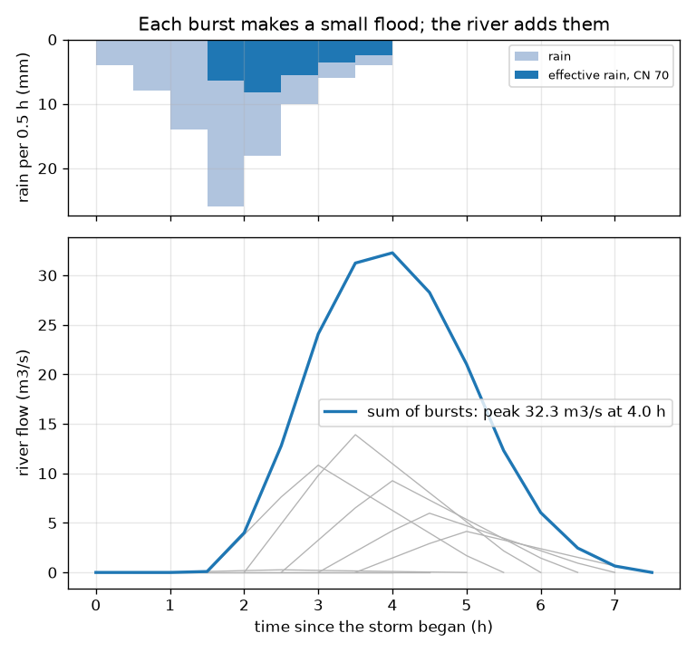
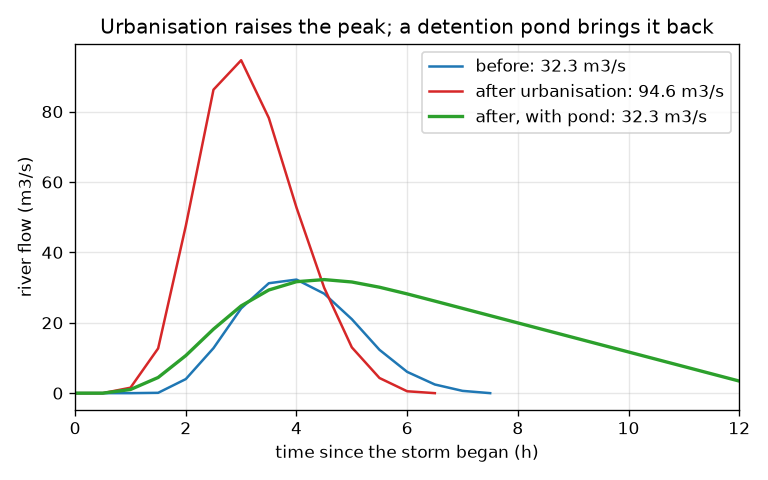

# Session 3: The unit hydrograph, urbanisation and a detention pond

*Level 3 (simulation and validation) · about 90 minutes · openwatershed*

> This is a simplified educational model. It is not a validated design tool and must not be used for real structures, electrical installations, vehicles, industrial processes or medical decisions.

**Prerequisites**

- Session 1: run-off and delay.
- Session 2: curve number run-off and Tc.
- Arrays in numpy (explained in the lesson).

**Learning objectives.** After this session you can:

- Build a flood hydrograph from rain bursts by discrete convolution with a triangular unit hydrograph.
- Check that the unit hydrograph conserves water and that np.convolve agrees with a loop.
- Quantify how urbanisation (curve number 70 to 90, shorter Tc) changes the peak and its timing.
- Route a flood through a channel (Muskingum) and a detention pond (level-pool routing) and verify water balance.

## A. Real-world problem
A stream gauge shows a curve, the hydrograph, not a single number. A real storm has bursts, and each makes its own little flood. Then a developer paves part of a 12 km2 valley (made up). How much higher and earlier is the new peak, and how large a pond holds it back to the old value? Educational model only: real flood studies use gauged data, official rainfall and qualified hydrologists.

## B. Concept and theory
Effective rain: the SCS run-off of the cumulative rain, differenced burst by burst. Unit hydrograph (UH): the response to 1 mm of effective rain in one burst of length D. The SCS triangular form (standard, approximate) has time to peak Tp = D/2 + 0.6 Tc, peak Qp = 0.208 A Pe / Tp (A in km2, Pe in mm, Tp in h, Qp in m3/s) and base time 2.67 Tp; the 0.208 follows from requiring the area under the triangle to equal 1 mm over A, i.e. 1000 A m3. Convolution: burst k with effective rain Pe[k] adds Pe[k] times the UH, shifted by k steps, so Q[n] = sum over k of Pe[k] U[n-k]. Urbanisation raises CN (more run-off) and shortens Tc (faster water). Muskingum routing: O[n+1] = C0 I[n+1] + C1 I[n] + C2 O[n] with the weights below (they add to 1); it delays and flattens a flood wave while keeping its volume. Detention pond (level pool): the water balance Ap dh/dt = I(t) - O(h) for a vertical-walled pond of surface area Ap with an orifice O = c sqrt(h); c is chosen so that O equals the old peak at the full depth H. We integrate with RK4 and find the smallest area by bisection. For this pond only the volume Ap H matters, not the chosen depth. Limits: the model is lumped, uses an approximate triangular UH, a fixed CN, and a simple outlet.

| Symbol | Meaning | Unit |
|---|---|---|
| Pe | effective (run-off) rain per burst | mm |
| A | catchment area (12) | km2 |
| Tc | time of concentration | h |
| D | burst length (0.5) | h |
| Tp | time to peak of the UH | h |
| Qp | UH peak per mm | m3/s |
| U[n] | UH ordinates | m3/s per mm |
| K, X | Muskingum travel time and weighting | h, no unit |
| I, O | inflow and outflow | m3/s |
| Ap, H, h | pond area, full depth, water depth | m2, m, m |

**Assumptions**

- The catchment is one lump with one CN and one Tc.
- The triangular UH is an approximation of the real response.
- Rain is uniform in space; bursts last 0.5 h.
- The pond has vertical walls and a simple orifice; no spillway.
- Educational model: not a design tool.

$$ T_p=\frac{D}{2}+0.6\,T_c,\qquad Q_p=\frac{0.208\,A\,P_e}{T_p},\qquad t_b=2.67\,T_p $$

$$ Q[n]=\sum_{k}P_e[k]\,U[n-k]\quad(\text{discrete convolution}) $$

$$ O_{n+1}=C_0 I_{n+1}+C_1 I_n+C_2 O_n,\ \ C_0=\frac{-KX+\Delta t/2}{K(1-X)+\Delta t/2},\ C_1=\frac{KX+\Delta t/2}{K(1-X)+\Delta t/2},\ C_2=\frac{K(1-X)-\Delta t/2}{K(1-X)+\Delta t/2} $$

$$ A_p\frac{dh}{dt}=I(t)-O(h),\qquad O=c\sqrt{h},\qquad \sqrt{h}=\sqrt{h_0}-\frac{c\,t}{2A_p}\ (I=0) $$

## C. Visual explanation
The first figure shows the 90 mm storm as eight 0.5 h bursts (top) and below each burst's own small flood in grey with their sum in blue: a peak of 32.3 m3/s at 4.0 h. The second figure compares three hydrographs: before development (blue, 32.3 m3/s), after urbanisation (red, 94.6 m3/s, a full hour earlier at 3.0 h) and after urbanisation with a detention pond (green): the pond cuts the peak back to 32.3 m3/s, delayed to 4.5 h, and releases the stored water over several hours.

*The storm as bursts (top) and each burst's small flood in grey with their sum in blue.*

*Before (blue), after urbanisation (red), and after urbanisation with a detention pond (green).*

## D. Interactive simulation
Run the lesson (`python start.py 3`), then open the live app: [Session 3: urbanisation and a detention pond](https://krunalpanchal1995.github.io/openwatershed/session-03/) (or `app.html` in this folder). Raise the curve number from 70 towards 90 and shrink Tc from 2.0 to 1.2 h: watch the blue hydrograph grow and shift earlier. Then add pond volume and watch the green curve flatten. Switch to the rain view to see how much of each burst runs off.

**Challenge.** On the paved valley (CN 90, Tc 1.2 h) choose a pond volume between 475 and 500 thousand m3 so that the peak stays at or below the old 32.3 m3/s.

## E. Worked example and experiment
**Problem.** For the 12 km2 catchment, find the unit hydrograph for Tc = 2 h and D = 0.5 h, then the peaks before (CN 70, Tc 2.0 h) and after (CN 90, Tc 1.2 h) urbanisation, and the pond that restores the old peak.

1. Tp = 0.5/2 + 0.6 * 2.0 = 1.45 h. Qp = 0.208 * 12 / 1.45 = 1.72 m3/s per mm. The UH holds 1 mm = 12 000 m3.
2. Effective rain of the 90 mm storm: 26.3 mm at CN 70 (the first hour of 12 mm is absorbed) and 63.2 mm at CN 90.
3. Convolve each burst with the UH and add: before, the peak is 32.3 m3/s at 4.0 h.
4. After (CN 90, Tc 1.2 h) the peak is 94.6 m3/s at 3.0 h: 2.9 times higher and 1 h earlier. The extra run-off volume is (63.2 - 26.3) mm * 12 km2 = 443 thousand m3.
5. Route the urbanised flood through a pond with an orifice that passes 32.3 m3/s at 2 m depth. Bisection gives a surface area of 226 857 m2, so the volume is about 454 thousand m3.
6. Checks: the outflow peak is 32.3 m3/s at 4.5 h, the water balance closes, and a pond half that size overtops (stage 3.31 m, outflow peak 41.5 m3/s).

**Answer.** Peaks of 32.3 m3/s (before) and 94.6 m3/s (after); a pond of about 454 thousand m3 (226 857 m2 at 2 m) restores 32.3 m3/s, with the peak delayed to 4.5 h.

**Experiment.** Compare with a real urbanising catchment: take stream gauge records of similar storms before and after development and compare the peaks and the lag between rain and peak; or measure the drainage of a bucket with a hole and compare it with the exact formula sqrt(h) = sqrt(h0) - c t / (2 Ap). Real catchments differ from the model through uneven rain, soil wetness, storm drains, and the fact that real ponds have spillways and sloping banks.

## Real-world application and mini-project: Urbanise a valley and size the detention pond
A developer wants to pave part of the made-up 12 km2 catchment of Session 3: the curve number rises from 70 to 90 and the time of concentration falls from 2.0 h to 1.2 h. Using the shipped functions, compute the 90 mm storm hydrograph before and after, report the peaks and their times, then find the smallest pond volume that brings the peak back to the pre-development value. Use a pond with vertical walls and an orifice outlet that passes the old peak at a depth of 2 m.

**Deliverable:** A script that prints, before and after, the effective rain, the peak and the time to peak, then the pond area and volume, checks the water balance of the pond, and saves a figure with the three hydrographs.

**Success looks like:** Peaks of 32.3 m3/s at 4.0 h before and 94.6 m3/s at 3.0 h after; a pond of about 454 thousand m3 (226 857 m2 at 2 m depth) whose outflow peak is 32.3 m3/s; and a pond half that size overtops, with a stage of 3.3 m.

## F. Assessment and design challenge
**Question type A: Conceptual.** Why does the flood hydrograph equal the sum of shifted copies of the unit hydrograph, and what two assumptions make that valid?

Hint

Think about doubling the rain and about two bursts at different times.

Step-by-step solution

If the catchment responds linearly, twice the effective rain gives twice the flow (scaling), and two bursts at different times give the sum of their responses (superposition), shifted by the delay between them. That is exactly a discrete convolution. The assumptions are linearity and time invariance: the response does not depend on how wet the catchment is or on when the rain falls, which is only approximately true.

**Question type B: Numerical.** A catchment has A = 8 km2 and Tc = 1.5 h; the burst length is D = 0.5 h. Find Tp and the UH peak per mm. Check the 0.208 factor.

Hint

Tp = D/2 + 0.6 Tc; Qp = 0.208 A / Tp. For the factor, 1000 / (0.5 * 2.67 * 3600).

Step-by-step solution

Tp = 0.25 + 0.9 = 1.15 h. Qp = 0.208 * 8 / 1.15 = 1.45 m3/s per mm. Check: 1000 / (0.5 * 2.67 * 3600) = 0.208, so the triangle with base 2.67 Tp holds 1 mm over A.

**Question type C: Graph and simulation interpretation.** In the urbanisation figure, by how much do the peak and its time change, and which of the two changes (CN or Tc) matters more for the peak?

Hint

Compare the red curve with the blue one; the lesson also runs each change on its own.

Step-by-step solution

The peak rises from 32.3 to 94.6 m3/s (2.9 times) and comes 1 h earlier (4.0 h to 3.0 h). The curve number alone gives 76.0 m3/s at 3.5 h and a faster Tc alone gives only 39.3 m3/s at 3.0 h, so the larger run-off (CN) matters more for the size and the faster concentration mainly shifts the timing and adds the rest.

**Question type D: Design and optimisation challenge.** Design: you can build the pond 1 m, 2 m or 3 m deep, with the orifice always passing 32.3 m3/s at the full depth. How does the required volume change, and what does a 1 m deep pond need in surface area? What trade-offs would you weigh?

Hint

Try size_pond with different H and compare Ap * H.

Step-by-step solution

The volume stays the same (about 454 thousand m3) for all three depths, because in this vertical-wall model the dynamics depend only on the ratio of stored volume to capacity. A 1 m pond therefore needs about 454 thousand m2 (45 ha), a 2 m pond 227 thousand m2 and a 3 m pond 151 thousand m2. Trade-offs: deep ponds need less land but are a drowning hazard and need stronger embankments; shallow ponds use more land. A real design also needs a spillway for larger storms, and a qualified engineer.

Score yourself with [RUBRIC.md](../../RUBRIC.md). Print the [activity sheet](activity_sheet.md) to work on paper.

## Common misconceptions
| Common misconception | What is actually true |
|---|---|
| A bigger storm total always means a later peak. | Urbanisation raises the total run-off and also shortens the response, so the peak is larger and earlier. |
| A pond removes the flood water. | A detention pond only holds water back and releases it later: the peak falls, the volume stays the same, and the outflow lasts longer. |
| Muskingum routing creates or destroys water. | It keeps the volume; it only delays and flattens the wave. |
| The unit hydrograph is measured once and valid for any storm. | It is a model assuming a linear, unchanging catchment. Wet soil or a very large storm can break that assumption. |

## Glossary
- **unit hydrograph**: the flow response to 1 mm of effective rain in one burst
- **effective rain**: the part of the rain that runs off
- **convolution**: adding scaled and shifted copies of a response
- **Muskingum routing**: a simple method that delays and flattens a flood wave in a river reach
- **detention pond**: a basin that holds back run-off and releases it slowly
- **level-pool routing**: tracking the water level of a tank from the water balance of inflow and outflow

## Finish
1. Do the three coding tasks in [exercises.md](exercises.md).
2. Run `python start.py 3` again after your changes. It ends with the checkpoint; when it prints `PASS`, you are done. (Checkpoint only: `python start.py check 3`.)

Next: the [roadmap](../../promo/roadmap.md). Session 4 is yours to build.
